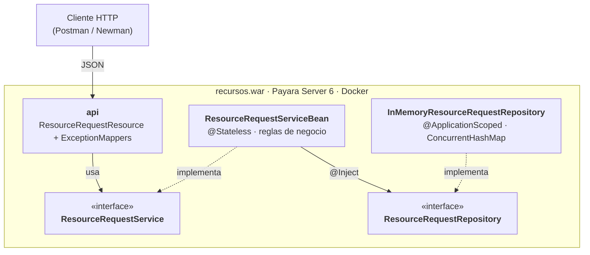

# Gestión de Recursos en Emergencias — Tier de Negocio (Jakarta EE)

Taller No. 2 — Jakarta EE + Tier de Negocio · Arquitectura de Software · Pontificia Universidad Javeriana (2026-30)

Tier de negocio de un módulo que administra las solicitudes de recursos (agua, mantas, medicamentos…) registradas por los centros de atención durante emergencias como inundaciones, incendios o deslizamientos.

Las reglas de negocio están en un **EJB de sesión sin estado** (`@Stateless`). El EJB depende de un **puerto de almacenamiento** (`ResourceRequestRepository`) y no de la implementación concreta, que en este taller es una colección en memoria.

## Arquitectura



### Cómo se desacopla el tier de negocio del tier de datos

- **El negocio define el puerto.** `ResourceRequestRepository` vive en `business.port`: el negocio declara qué necesita (guardar, buscar por id, listar) sin saber cómo se hace.
- **Las dependencias apuntan hacia el negocio.** `data.memory` implementa el puerto; ninguna clase de `business` importa algo de `data`.
- **El contenedor conecta las piezas.** El EJB recibe la implementación con `@Inject` y nunca la nombra.
- **El repositorio no tiene reglas.** Solo almacena; validaciones, estados y el filtro de pendientes están en el EJB.
- **Demostración.** Las pruebas del EJB usan un repositorio simulado (Mockito) en lugar del real. Reemplazar la memoria por JPA/PostgreSQL solo requeriría otra implementación del puerto; `business`, `api` y `domain` no cambiarían.

La documentación completa, con las vistas 4+1, está en [`docs/arquitectura.md`](docs/arquitectura.md):

| Vista | Contenido |
|---|---|
| [Desarrollo](docs/arquitectura.md#vista-de-desarrollo) | Paquetes, capas, dependencias y desacoplamiento |
| [Lógica](docs/arquitectura.md#vista-lógica) | Clases, contratos, EJB y excepciones |
| [Procesos](docs/arquitectura.md#vista-de-procesos) | Secuencias de registrar, consultar y atender |
| [Física / despliegue](docs/arquitectura.md#vista-física--despliegue) | Docker → Payara 6 → WAR |
| [Escenarios](docs/arquitectura.md#escenarios) | Casos de uso que recorren las vistas |

## Requerimientos cubiertos

### Funcionales

| Requerimiento | Operación del EJB | Endpoint |
|---|---|---|
| Registrar una solicitud | `register` | `POST /requests` |
| Consultar todas las solicitudes | `findAll` | `GET /requests` |
| Buscar una solicitud por id | `findById` | `GET /requests/{id}` |
| Atender una solicitud (PENDIENTE → ATENDIDA) | `attend` | `PUT /requests/{id}/attend` |
| Consultar solo las pendientes | `findPending` | `GET /requests/pending` |

### Reglas de negocio

Todas se validan en `ResourceRequestServiceBean`. La API REST no valida datos: solo traduce las excepciones de negocio a códigos HTTP.

| Regla | Si se incumple |
|---|---|
| La cantidad debe ser mayor que cero | `BusinessValidationException` → 400 |
| Descripción del desastre y tipo de recurso obligatorios | `BusinessValidationException` → 400 |
| Prioridad obligatoria: `BAJA`, `MEDIA` o `ALTA` | `BusinessValidationException` → 400 |
| Toda solicitud nueva inicia en `PENDIENTE` | El sistema asigna el estado; el cliente no lo envía |
| No se puede atender una solicitud inexistente | `RequestNotFoundException` → 404 |
| No se puede atender de nuevo una solicitud `ATENDIDA` | `AlreadyAttendedException` → 409 |

## Stack

Java 17 · Jakarta EE 10 (EJB, CDI, JAX-RS, JSON-B) · Payara Server 6 · Maven (WAR) · Docker · JUnit 5 · Mockito

Persistencia: colección en memoria. El taller no usa base de datos.

## Estructura

```text
src/main/java/co/edu/javeriana/recursos
├── api
│   ├── resource    ResourceRequestResource (endpoints REST)
│   ├── request     CreateResourceRequestBody (JSON de entrada)
│   ├── response    ErrorResponse (formato uniforme de error)
│   └── exception   ExceptionMappers → 400 / 404 / 409 / 500
├── business
│   ├── contract    ResourceRequestService, CreateResourceRequestCommand, ResourceRequestView
│   ├── ejb         ResourceRequestServiceBean (@Stateless)
│   ├── exception   BusinessValidationException, RequestNotFoundException, AlreadyAttendedException
│   └── port        ResourceRequestRepository
├── domain.model    ResourceRequest, Priority, RequestStatus
└── data.memory     InMemoryResourceRequestRepository
docs/
├── arquitectura.md vistas 4+1 y explicación del desacoplamiento
├── api.md          endpoints, ejemplos y errores
└── evidencias/     colección Postman y resultados de la ejecución
```

## Ejecución

Requisitos: Docker. Para compilar y probar fuera de Docker: JDK 17+ y Maven 3.9+.

```bash
docker build -t recursos-negocio .
docker run --rm -p 8080:8080 --name recursos recursos-negocio
```

La API queda en `http://localhost:8080/recursos/api`. Si el puerto 8080 está ocupado, publicar otro: `-p 8081:8080`.

```bash
curl http://localhost:8080/recursos/api/requests
```

La imagen se construye en dos etapas: Maven compila el WAR y luego se despliega en `payara/server-full:6.2024.6-jdk17`. No hace falta tener Java ni Maven instalados para ejecutarla.

## API

| Método | Ruta | Descripción | Éxito |
|---|---|---|---|
| POST | `/requests` | Registrar solicitud | 201 + `Location` |
| GET | `/requests` | Listar todas | 200 |
| GET | `/requests/{id}` | Consultar por id | 200 |
| GET | `/requests/pending` | Listar pendientes | 200 |
| PUT | `/requests/{id}/attend` | Atender solicitud | 200 |

```json
{
  "disasterDescription": "Inundación en el sector norte",
  "resourceType": "Agua potable",
  "quantity": 200,
  "priority": "ALTA"
}
```

Los errores siempre tienen el formato `{ "code", "message", "timestamp" }`. Ejemplos, todos los códigos de error y su origen: [`docs/api.md`](docs/api.md).

## Pruebas

```bash
mvn clean test
```

46 pruebas unitarias, sin servidor:

| Clase de prueba | Pruebas | Qué verifica |
|---|---|---|
| `ResourceRequestServiceBeanTest` | 21 | Reglas de negocio del EJB con un repositorio simulado (Mockito) |
| `InMemoryResourceRequestRepositoryTest` | 11 | Ids automáticos, copias defensivas y concurrencia (8 hilos) |
| `ResourceRequestResourceTest` | 7 | La API delega en el servicio simulado y responde 201/200 |
| `ExceptionMappersTest` | 7 | Cada excepción produce su código HTTP y el formato uniforme |

## Evidencias

En [`docs/evidencias/`](docs/evidencias/README.md) está la ejecución de la colección Postman contra la aplicación desplegada en Docker + Payara 6: **21 peticiones, 61 verificaciones, 0 fallos**. Para cada operación se muestra la petición, la respuesta real del servidor y las verificaciones.

Para repetirla: importar `docs/evidencias/recursos.postman_collection.json` en Postman y ejecutarla completa con el Runner, o usar la línea de comandos:

```bash
npx newman run docs/evidencias/recursos.postman_collection.json \
  --env-var "baseUrl=http://localhost:8080/recursos/api"
```

## Integrantes

| Integrante | Responsabilidades |
|---|---|
| André Landinez | Configuración (Maven, Payara, Docker), dominio, contratos y excepciones, repositorio en memoria, API REST y manejo de errores, vistas de desarrollo y física, documentación de la API y evidencias |
| Andrés Barrios | Propuesta inicial de arquitectura, EJB y reglas de negocio, pruebas del EJB, vistas lógica, de procesos y escenarios, integración final |
