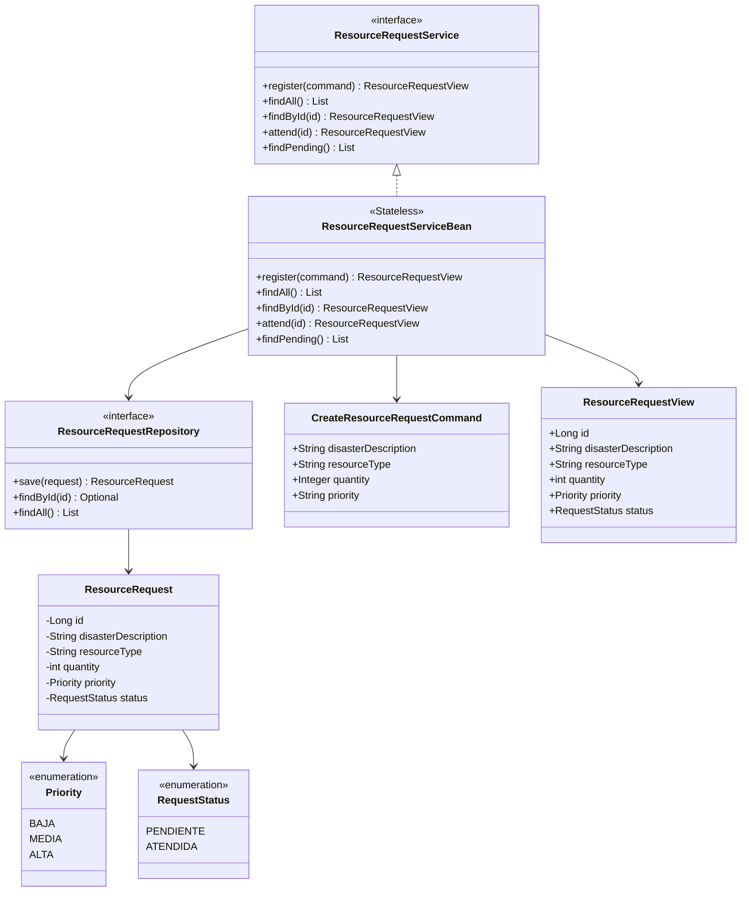
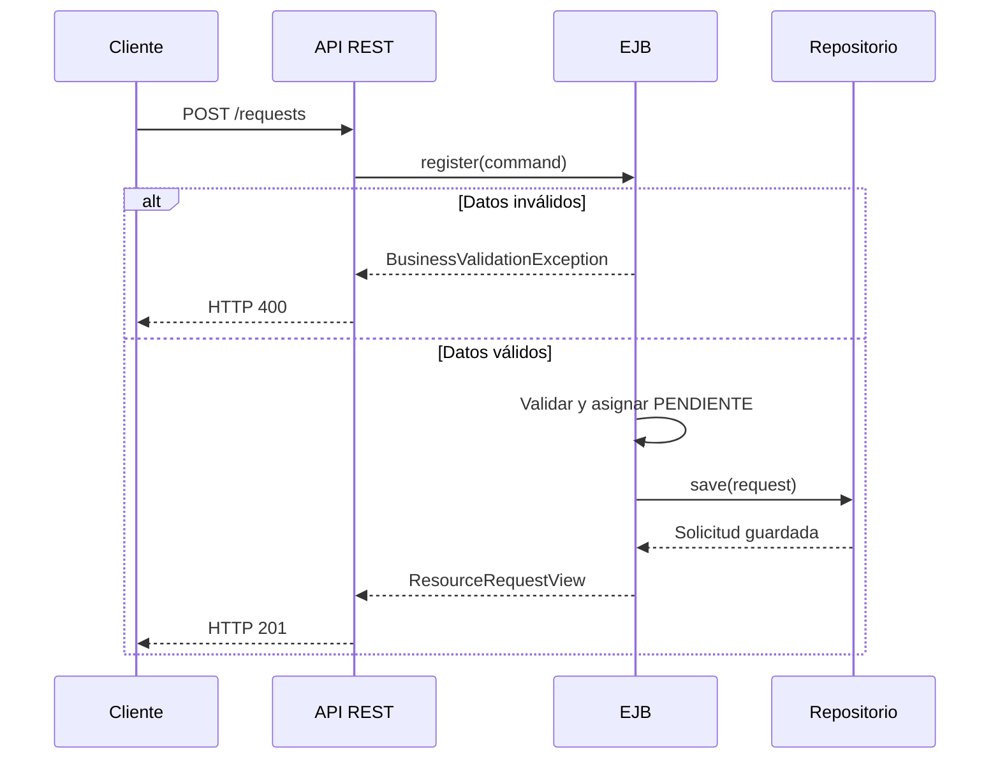
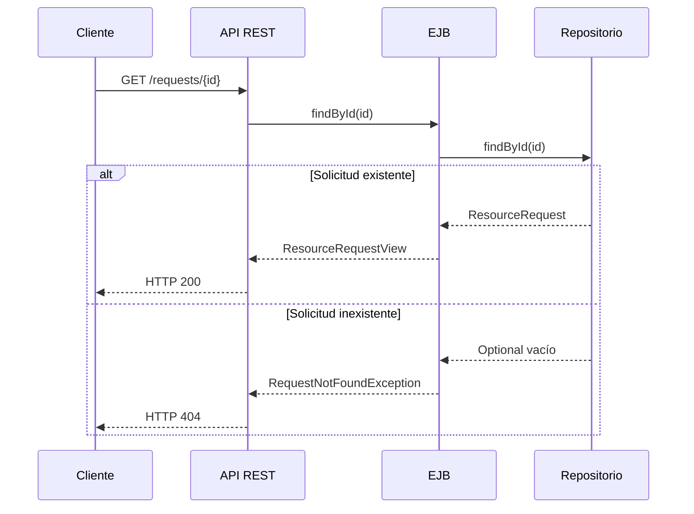
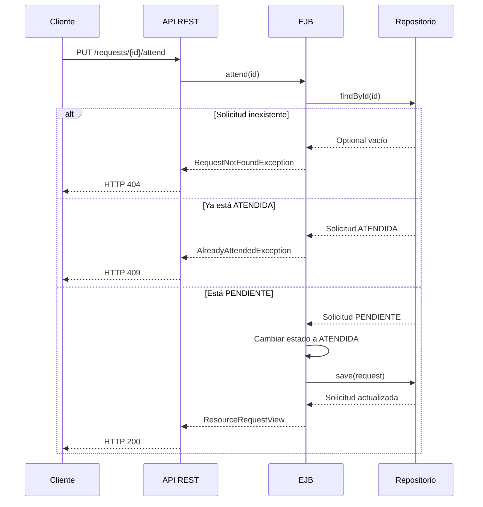
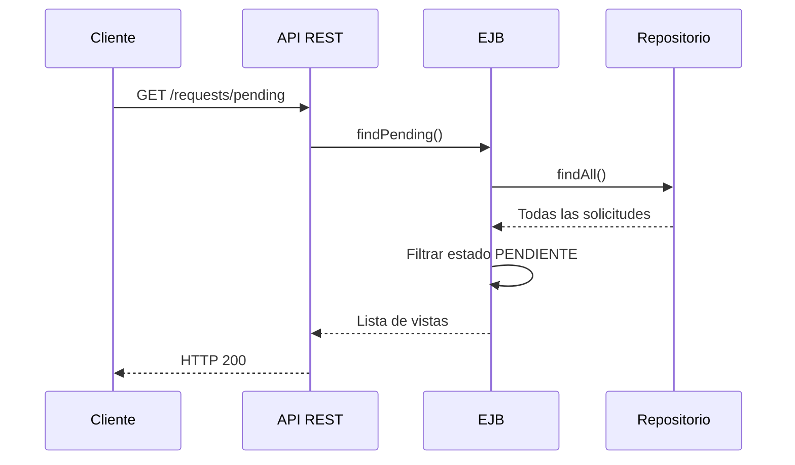

# Arquitectura — Gestión de Recursos en Emergencias

Documentación con el modelo de vistas 4+1. Las vistas se reparten entre los dos integrantes; lo que comparten son las **interfaces** (`ResourceRequestService` y `ResourceRequestRepository`), que ambas vistas deben respetar.

| Vista | Responsable | Contenido |
|---|---|---|
| Desarrollo | Rol 1 | Paquetes y capas, dependencias entre módulos, cómo el puerto desacopla negocio y datos, empaquetado WAR |
| Lógica | Rol 2 | Clases del dominio, contratos, EJB, excepciones |
| Procesos | Rol 2 | Secuencias de registrar, consultar, atender (incluye errores 400/404/409) |
| Física / despliegue | Rol 1 | Contenedor Docker → Payara 6 → WAR |
| Escenarios | Rol 2 | Casos de uso que recorren las vistas anteriores |

## Interfaces compartidas

```java
@Local
public interface ResourceRequestService {
    ResourceRequestView register(CreateResourceRequestCommand command);
    List<ResourceRequestView> findAll();
    ResourceRequestView findById(Long id);
    ResourceRequestView attend(Long id);
    List<ResourceRequestView> findPending();
}

public interface ResourceRequestRepository {
    ResourceRequest save(ResourceRequest request);
    Optional<ResourceRequest> findById(Long id);
    List<ResourceRequest> findAll();
}
```

## Vista de desarrollo

_Pendiente (Rol 1)._

## Vista lógica

La vista lógica presenta las clases principales y sus relaciones sin considerar detalles de despliegue.



El cliente del negocio depende de `ResourceRequestService`, mientras que el EJB depende de `ResourceRequestRepository`. Ninguna operación del EJB conoce la implementación concreta del almacenamiento.

Las excepciones expresan los resultados inválidos del negocio:

| Excepción | Situación | Respuesta HTTP |
|---|---|---:|
| `BusinessValidationException` | Datos obligatorios ausentes o inválidos | 400 |
| `RequestNotFoundException` | La solicitud consultada no existe | 404 |
| `AlreadyAttendedException` | La solicitud ya estaba atendida | 409 |

## Vista de procesos

### Registrar una solicitud



La identificación y el estado no se reciben desde REST. El repositorio genera el identificador y el EJB asigna siempre `PENDIENTE`.

### Consultar una solicitud



### Atender una solicitud



El EJB llama nuevamente a `save()` porque el repositorio trabaja con copias de los objetos almacenados.

### Listar solicitudes pendientes



El filtrado se realiza en el tier de negocio. El repositorio no conoce reglas relacionadas con estados.

## Vista física / despliegue

_Pendiente (Rol 1)._

## Escenarios

| Escenario | Flujo principal | Resultado |
|---|---|---|
| Registrar una solicitud válida | El cliente envía descripción, tipo, cantidad y prioridad | Solicitud creada con identificador y estado `PENDIENTE` |
| Registrar datos inválidos | Falta un campo obligatorio, la cantidad no es positiva o la prioridad no existe | `BusinessValidationException` y HTTP 400 |
| Consultar una solicitud | El cliente consulta un identificador existente | Se devuelve la información de la solicitud |
| Consultar un identificador inexistente | El repositorio no encuentra la solicitud | `RequestNotFoundException` y HTTP 404 |
| Listar solicitudes pendientes | El EJB consulta todas y filtra por estado | Solo se devuelven solicitudes `PENDIENTE` |
| Atender una solicitud pendiente | El EJB cambia el estado y guarda nuevamente | Solicitud actualizada a `ATENDIDA` |
| Atender una solicitud ya atendida | El estado actual es `ATENDIDA` | `AlreadyAttendedException` y HTTP 409 |

Estos escenarios conectan las vistas lógica, de procesos, de desarrollo y de despliegue mediante las interfaces compartidas.