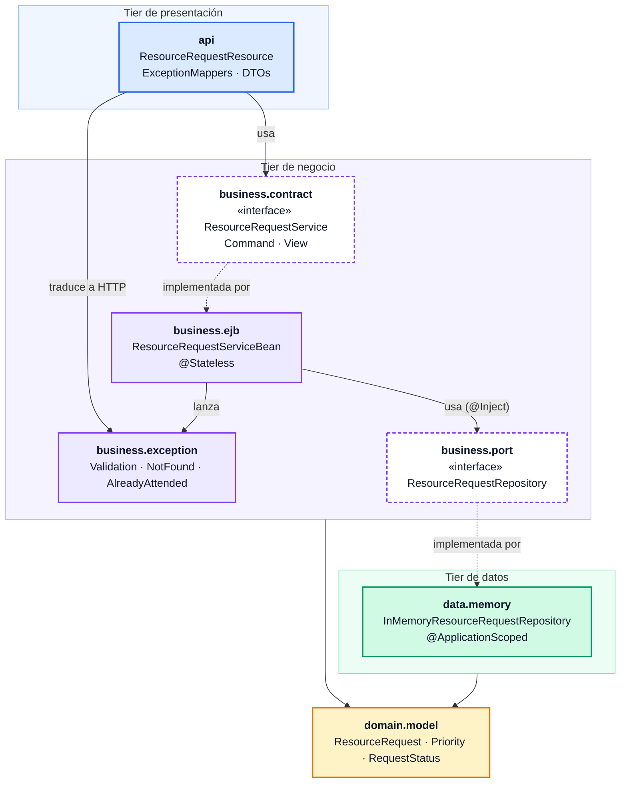
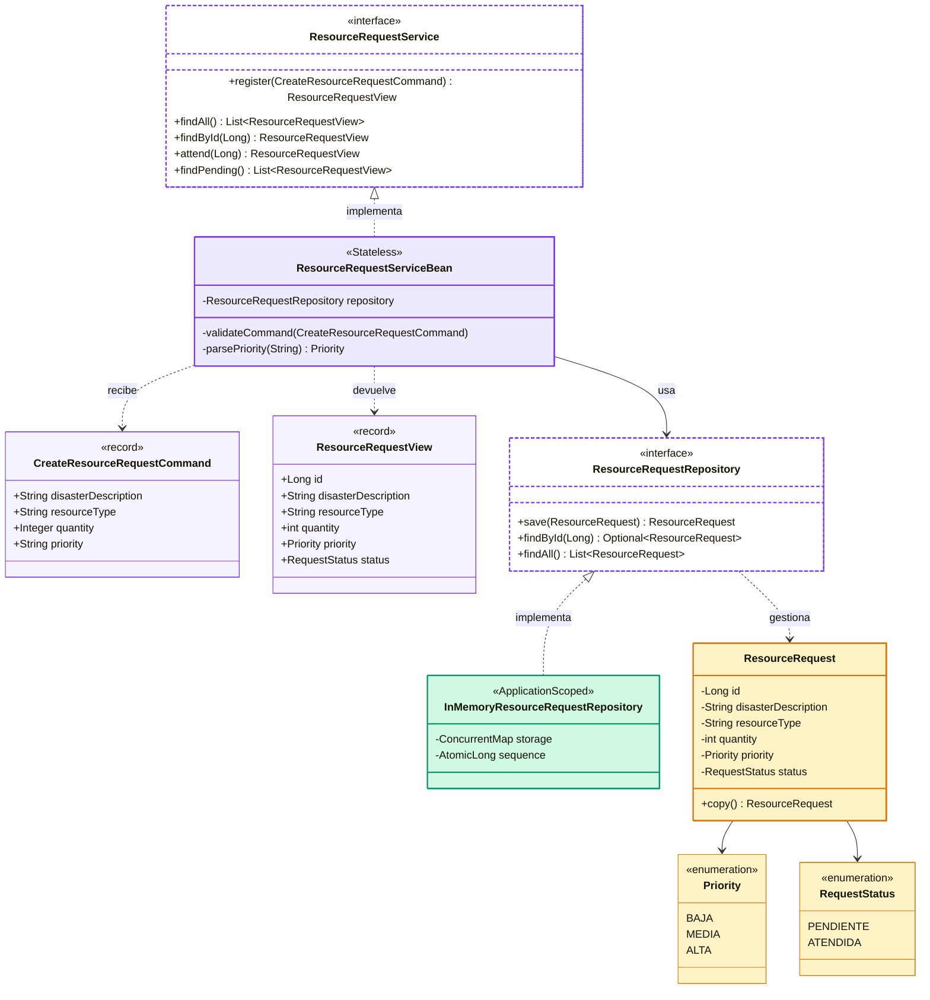
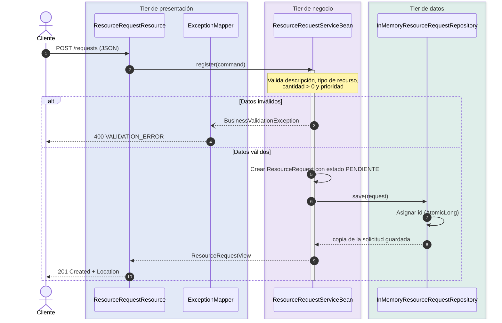
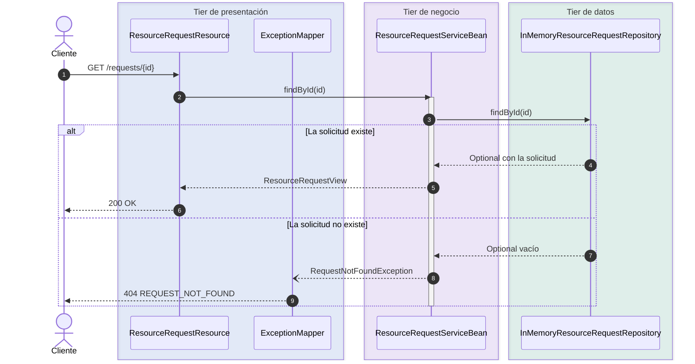
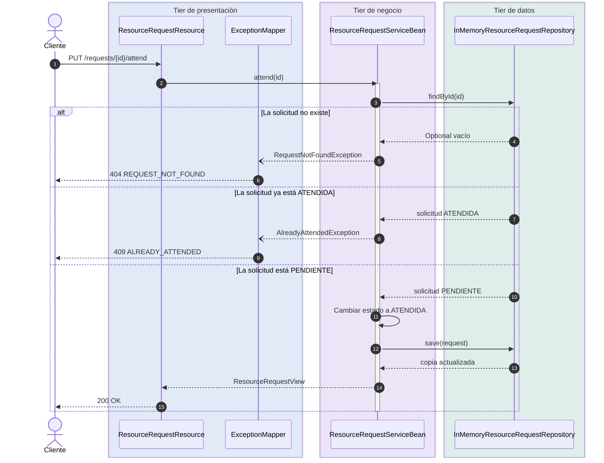
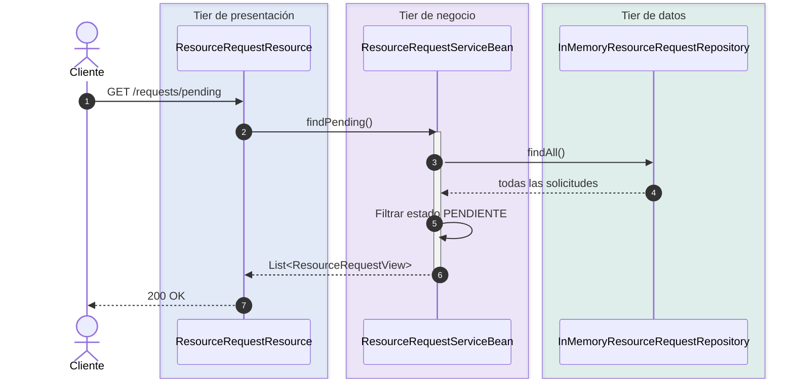
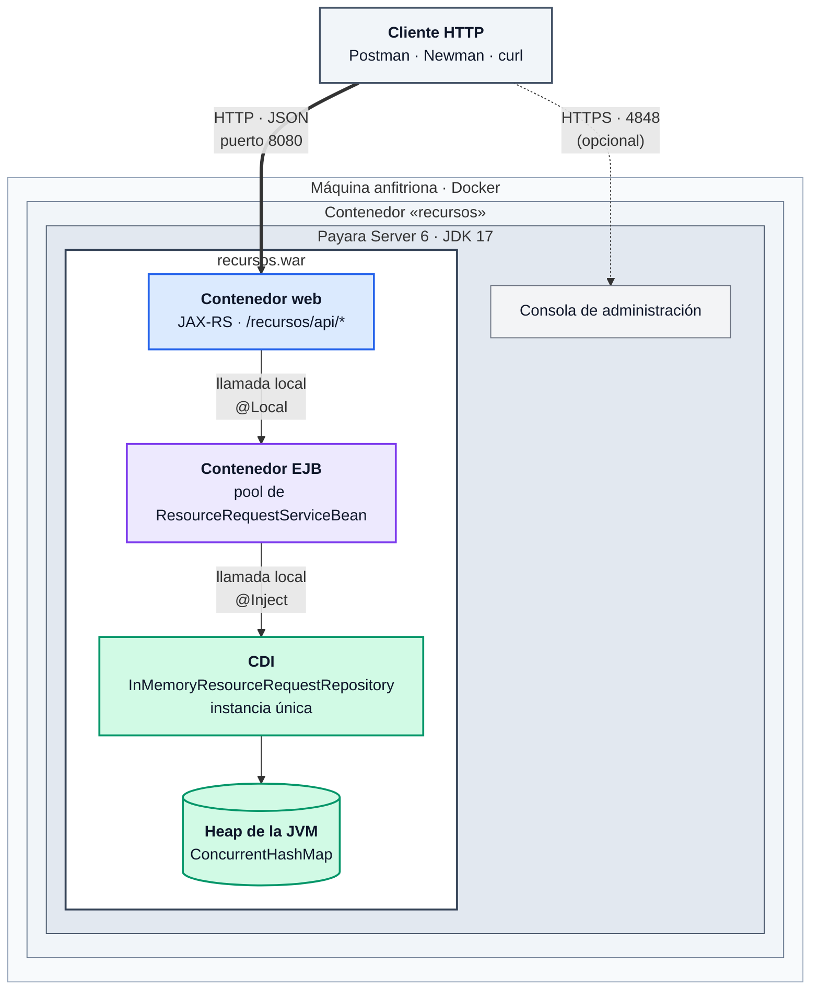
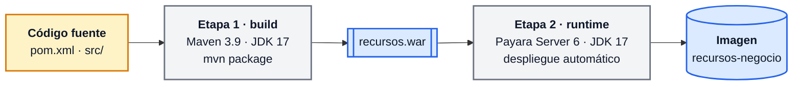
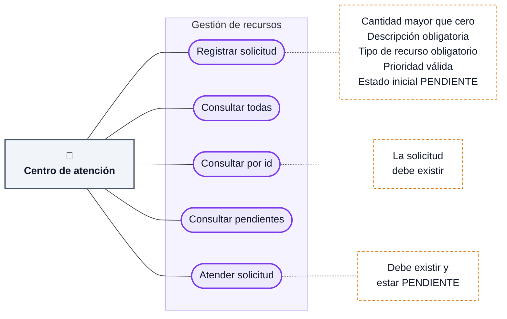

# Arquitectura — Gestión de Recursos en Emergencias

Este documento describe la arquitectura del tier de negocio mediante el modelo de vistas **4+1**. Las vistas comparten un mismo eje: dos interfaces que separan los tiers del sistema.

| Vista | Pregunta que responde |
|---|---|
| [Desarrollo](#vista-de-desarrollo) | ¿Cómo está organizado el código y en qué dirección van las dependencias? |
| [Lógica](#vista-lógica) | ¿Qué clases componen el sistema y cómo se relacionan? |
| [Procesos](#vista-de-procesos) | ¿Cómo colaboran los componentes en tiempo de ejecución? |
| [Física / despliegue](#vista-física--despliegue) | ¿Dónde se ejecuta el software? |
| [Escenarios](#escenarios) | ¿Qué casos de uso recorren las vistas anteriores? |

Convención de colores en todos los diagramas: **azul** presentación (REST), **violeta** negocio (EJB), **ámbar** dominio, **verde** datos, **gris** infraestructura.

## Interfaces entre tiers

```java
// Contrato del tier de negocio: lo usa la API y lo implementa el EJB
@Local
public interface ResourceRequestService {
    ResourceRequestView register(CreateResourceRequestCommand command);
    List<ResourceRequestView> findAll();
    ResourceRequestView findById(Long id);
    ResourceRequestView attend(Long id);
    List<ResourceRequestView> findPending();
}

// Puerto de almacenamiento: lo usa el EJB y lo implementa el tier de datos
public interface ResourceRequestRepository {
    ResourceRequest save(ResourceRequest request);
    Optional<ResourceRequest> findById(Long id);
    List<ResourceRequest> findAll();
}
```

## Vista de desarrollo

Muestra la organización del código en paquetes, las capas a las que pertenecen y la dirección de sus dependencias.

### Paquetes y dependencias



Las flechas continuas son dependencias de uso y las discontinuas unen cada interfaz (borde punteado) con su implementación. Ambas interfaces pertenecen al tier de negocio: `data.memory` implementa `business.port` y, por tanto, **el tier de datos depende del tier de negocio, y no al revés** (inversión de dependencias).

| Paquete | Tier | Responsabilidad | Depende de |
|---|---|---|---|
| `api` | Presentación | Traducir HTTP a llamadas al servicio y excepciones a códigos HTTP | `business.contract`, `business.exception` |
| `business.contract` | Negocio | Interfaz pública del tier de negocio y sus DTOs | `domain.model` |
| `business.ejb` | Negocio | Reglas y validaciones (EJB `@Stateless`) | `contract`, `exception`, `port`, `domain.model` |
| `business.exception` | Negocio | Errores de negocio (`@ApplicationException`) | — |
| `business.port` | Negocio | Contrato de almacenamiento que requiere el negocio | `domain.model` |
| `domain.model` | Dominio | Entidad y enumeraciones, sin dependencias de frameworks | — |
| `data.memory` | Datos | Almacenamiento en memoria que implementa el puerto | `business.port`, `domain.model` |

### Desacoplamiento entre el tier de negocio y el tier de datos

1. **El puerto pertenece al negocio.** `ResourceRequestRepository` se ubica en `business.port`, no en `data`. El negocio declara las operaciones que necesita (guardar, buscar por identificador, listar) sin conocer cómo se implementan.
2. **Inversión de dependencias.** `data.memory` depende de `business.port`, y no al revés. Ninguna clase de `business` importa elementos de `data`.
3. **Inyección por el contenedor.** El EJB declara `@Inject ResourceRequestRepository repository;` y CDI le entrega en tiempo de ejecución la única implementación disponible, `InMemoryResourceRequestRepository`. El EJB nunca nombra la clase concreta.
4. **Repositorio sin reglas de negocio.** El repositorio no valida cantidades ni estados y no filtra solicitudes pendientes; toda la lógica reside en el EJB. Cambiar el almacenamiento no altera las reglas.
5. **Copias defensivas.** El repositorio almacena y devuelve copias de las entidades. Un cambio solo se persiste cuando el EJB invoca `save()` explícitamente, igual que con una base de datos.

**Consecuencia:** reemplazar el almacenamiento en memoria por JPA/PostgreSQL requiere únicamente una nueva implementación del puerto, por ejemplo `data.jpa.JpaResourceRequestRepository`. Los paquetes `business`, `api` y `domain` no cambian. Las pruebas unitarias del EJB lo demuestran al ejecutarse con un repositorio simulado (Mockito) en lugar del real.

### Concurrencia del almacenamiento en memoria

- `@ApplicationScoped`: existe una sola instancia del repositorio, compartida por todas las instancias del pool de EJB `@Stateless`.
- `ConcurrentHashMap` para el almacenamiento y `AtomicLong` para generar identificadores únicos.
- Verificado en `InMemoryResourceRequestRepositoryTest.concurrentSavesAreSafe`: 8 hilos con 250 inserciones cada uno, sin identificadores repetidos ni pérdidas.
- Limitación conocida: dos invocaciones simultáneas de `attend` sobre la misma solicitud podrían superar ambas la verificación de estado `PENDIENTE`. Con una base de datos se resolvería mediante bloqueo optimista (columna de versión).

### Construcción y empaquetado

| Elemento | Detalle |
|---|---|
| Build | Maven, `maven.compiler.release=17` |
| API | `jakarta.jakartaee-api:10.0.0` (alcance `provided`, la aporta Payara) |
| Pruebas | JUnit 5 + Mockito (`mvn test`) |
| Artefacto | `target/recursos.war` (contexto `/recursos`, API REST en `/recursos/api`) |
| Imagen | `Dockerfile` multi-etapa (ver [vista física](#construcción-de-la-imagen)) |

```text
src/
├── main/java/co/edu/javeriana/recursos/   paquetes de la tabla anterior
├── main/webapp/WEB-INF/beans.xml          CDI, bean-discovery-mode="annotated"
└── test/java/co/edu/javeriana/recursos/   pruebas unitarias por paquete
```

## Vista lógica

Presenta las clases principales y sus relaciones, sin considerar detalles de despliegue.



El cliente del negocio depende de `ResourceRequestService` y el EJB depende de `ResourceRequestRepository`. `InMemoryResourceRequestRepository` implementa el puerto, pero el EJB solo se relaciona con la interfaz, nunca con la implementación concreta.

Las excepciones de negocio representan los resultados inválidos de cada operación:

| Excepción | Situación | Respuesta HTTP |
|---|---|---:|
| `BusinessValidationException` | Datos obligatorios ausentes o inválidos | 400 |
| `RequestNotFoundException` | La solicitud consultada no existe | 404 |
| `AlreadyAttendedException` | La solicitud ya estaba atendida | 409 |

Las tres están anotadas con `@ApplicationException(rollback = true)`, de modo que el contenedor EJB no las envuelve en `EJBException` y llegan intactas al `ExceptionMapper` correspondiente.

## Vista de procesos

Describe la colaboración entre componentes en tiempo de ejecución para cada operación. Todas las llamadas entre tiers son locales, dentro de la misma JVM.

### Registrar una solicitud



El cliente no envía el identificador ni el estado: el repositorio genera el identificador y el EJB asigna siempre `PENDIENTE`.

### Consultar una solicitud por identificador



### Atender una solicitud



El EJB invoca `save()` después de cambiar el estado porque el repositorio trabaja con copias: modificar el objeto recibido no altera lo almacenado.

### Consultar las solicitudes pendientes



El filtrado ocurre en el tier de negocio; el repositorio no conoce reglas relacionadas con los estados. La consulta de todas las solicitudes (`GET /requests`) sigue el mismo flujo sin el paso de filtrado.

## Vista física / despliegue

Muestra los nodos y contenedores donde se ejecuta el software y cómo se comunican.

### Diagrama de despliegue



| Nodo / artefacto | Detalle |
|---|---|
| Máquina anfitriona | Cualquier equipo con Docker; un solo nodo |
| Contenedor `recursos` | Imagen construida con el `Dockerfile` del proyecto |
| Servidor de aplicaciones | Payara Server 6 (Jakarta EE 10) sobre JDK 17 |
| Artefacto desplegado | `recursos.war`, copiado a `$DEPLOY_DIR` y desplegado al arrancar |
| Puertos | `8080` HTTP (API REST); `4848` consola de administración (opcional) |
| Almacenamiento | Sin almacenamiento externo: los datos residen en el heap de la JVM |

Todas las llamadas internas (REST → EJB → repositorio) son **locales** dentro de la misma JVM (`@Local`), sin serialización ni red. La única comunicación por red es la del cliente con la API.

### Construcción de la imagen



Imágenes base: `maven:3.9-eclipse-temurin-17` para compilar y `payara/server-full:6.2024.6-jdk17` para ejecutar; el WAR se copia a `$DEPLOY_DIR` y Payara lo despliega al arrancar. La imagen final contiene únicamente Payara y el WAR, sin Maven ni el código fuente. No se requiere Java ni Maven en la máquina anfitriona.

```bash
docker build -t recursos-negocio .
docker run --rm -p 8080:8080 --name recursos recursos-negocio
```

### Implicaciones del despliegue

- **Datos volátiles.** Al reiniciar o eliminar el contenedor se pierden las solicitudes, comportamiento esperado para una colección en memoria.
- **Una sola instancia.** Con varios contenedores detrás de un balanceador, cada uno tendría su propio `Map` y los datos serían inconsistentes.
- **Evolución.** Para persistir y escalar horizontalmente basta con agregar un nodo de base de datos y una implementación del puerto (por ejemplo, JPA). Gracias al desacoplamiento descrito en la vista de desarrollo, el EJB y la API no cambian.

## Escenarios

El diagrama muestra los casos de uso del sistema y las reglas de negocio que aplica cada uno. Cada escenario recorre las demás vistas: entra por el tier de presentación ([desarrollo](#vista-de-desarrollo)), aplica las reglas en el EJB ([lógica](#vista-lógica)), sigue una de las secuencias de la [vista de procesos](#vista-de-procesos) y se ejecuta en el contenedor descrito en la [vista física](#vista-física--despliegue). Todos están verificados en las [evidencias](evidencias/README.md).



| Escenario | Flujo principal | Resultado |
|---|---|---|
| Registrar una solicitud válida | El cliente envía descripción, tipo de recurso, cantidad y prioridad | Solicitud creada con identificador y estado `PENDIENTE` (201) |
| Registrar datos inválidos | Falta un campo obligatorio, la cantidad no es positiva o la prioridad no existe | `BusinessValidationException` (400) |
| Consultar una solicitud | El cliente consulta un identificador existente | Se devuelve la solicitud (200) |
| Consultar un identificador inexistente | El repositorio no encuentra la solicitud | `RequestNotFoundException` (404) |
| Consultar solicitudes pendientes | El EJB consulta todas y filtra por estado | Solo solicitudes `PENDIENTE` (200) |
| Atender una solicitud pendiente | El EJB cambia el estado y la guarda nuevamente | Solicitud en estado `ATENDIDA` (200) |
| Atender una solicitud ya atendida | El estado actual es `ATENDIDA` | `AlreadyAttendedException` (409) |
| Atender una solicitud inexistente | El repositorio no encuentra la solicitud | `RequestNotFoundException` (404) |
