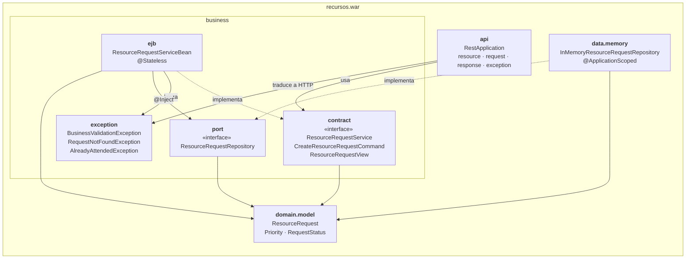

# Arquitectura — Gestión de Recursos en Emergencias

Documentación con el modelo de vistas 4+1. Las vistas se reparten entre los dos integrantes; lo que comparten son las **interfaces** (`ResourceRequestService` y `ResourceRequestRepository`), que ambas vistas deben respetar.

| Vista | Responsable | Contenido |
|---|---|---|
| Desarrollo | Rol 1 | Paquetes y capas, dependencias entre módulos, cómo el puerto desacopla negocio y datos, empaquetado WAR |
| Lógica | Rol 2 | Clases del dominio, contratos, EJB, excepciones |
| Procesos | Rol 2 | Secuencias de registrar, consultar, atender (incluye errores 400/404/409) |
| Física / despliegue | Rol 1 | Contenedor Docker → Payara 6 → WAR |
| Escenarios | Rol 2 | Casos de uso que recorren las vistas anteriores |

## Interfaces compartidas

```java
@Local
public interface ResourceRequestService {
    ResourceRequestView register(CreateResourceRequestCommand command);
    List<ResourceRequestView> findAll();
    ResourceRequestView findById(Long id);
    ResourceRequestView attend(Long id);
    List<ResourceRequestView> findPending();
}

public interface ResourceRequestRepository {
    ResourceRequest save(ResourceRequest request);
    Optional<ResourceRequest> findById(Long id);
    List<ResourceRequest> findAll();
}
```

## Vista de desarrollo

Muestra cómo está organizado el código: módulos (paquetes), capas y la dirección de las dependencias entre ellos.

### Paquetes y dependencias



| Paquete | Capa | Responsabilidad | Puede depender de |
|---|---|---|---|
| `api` | Presentación (REST) | Traducir HTTP ↔ llamadas al servicio y excepciones ↔ códigos HTTP | `business.contract`, `business.exception` |
| `business.contract` | Negocio | Interfaz pública del tier de negocio y sus DTOs | `domain.model` |
| `business.ejb` | Negocio | Reglas y validaciones (EJB `@Stateless`) | `contract`, `exception`, `port`, `domain.model` |
| `business.exception` | Negocio | Errores de negocio (`@ApplicationException`) | — |
| `business.port` | Negocio | Contrato de almacenamiento que el negocio necesita | `domain.model` |
| `domain.model` | Dominio | Entidad y enums, sin dependencias de frameworks | — |
| `data.memory` | Datos | Almacenamiento en memoria que implementa el puerto | `business.port`, `domain.model` |

### Cómo se desacopla el negocio de los datos

1. **El puerto pertenece al negocio.** `ResourceRequestRepository` está en `business.port`, no en `data`. El negocio define qué necesita (guardar, buscar por id, listar) sin saber cómo se hace.
2. **Las dependencias apuntan hacia el negocio (inversión de dependencias).** `data.memory` depende de `business.port`, y no al revés. Ninguna clase de `business` importa algo de `data`.
3. **CDI conecta las piezas en tiempo de ejecución.** El EJB declara `@Inject ResourceRequestRepository repository;` y el contenedor le entrega `InMemoryResourceRequestRepository`, la única implementación disponible. El EJB nunca la nombra.
4. **El repositorio no tiene reglas de negocio.** No valida cantidades ni estados y no filtra pendientes. Toda la lógica está en el EJB, así que cambiar el almacenamiento no cambia las reglas.
5. **Copias defensivas.** El repositorio guarda y devuelve copias, así que un cambio solo queda persistido cuando el EJB llama explícitamente a `save()`, igual que pasaría con una base de datos.

**Consecuencia:** reemplazar la memoria por JPA/PostgreSQL implica crear, por ejemplo, `data.jpa.JpaResourceRequestRepository implements ResourceRequestRepository` y retirar la implementación en memoria. `business`, `api` y `domain` no cambian. Las pruebas del EJB lo demuestran usando un mock de Mockito en lugar del repositorio real.

### Concurrencia del almacenamiento en memoria

- `@ApplicationScoped`: una sola instancia compartida por todas las instancias del pool de EJB `@Stateless`.
- `ConcurrentHashMap` para el almacenamiento y `AtomicLong` para generar ids sin repetir.
- Probado en `InMemoryResourceRequestRepositoryTest.concurrentSavesAreSafe` (8 hilos × 250 inserciones, sin ids repetidos ni pérdidas).
- Limitación conocida: dos llamadas simultáneas a `attend` sobre la misma solicitud podrían pasar ambas la verificación de `PENDIENTE`. Para este taller se acepta; en producción se resolvería con bloqueo optimista (versión) en la persistencia.

### Construcción y empaquetado

| Elemento | Detalle |
|---|---|
| Build | Maven, `maven.compiler.release=17` |
| API | `jakarta.jakartaee-api:10.0.0` (`provided`, la aporta Payara) |
| Pruebas | JUnit 5 + Mockito (`mvn test`) |
| Artefacto | `target/recursos.war` (contexto `/recursos`, REST en `/recursos/api`) |
| Imagen | `Dockerfile` multi-etapa: `maven:3.9-eclipse-temurin-17` compila → `payara/server-full:6.2024.6-jdk17` despliega |

```text
src/
├── main/java/co/edu/javeriana/recursos/   (paquetes de la tabla anterior)
├── main/webapp/WEB-INF/beans.xml          (CDI, bean-discovery-mode="annotated")
└── test/java/co/edu/javeriana/recursos/   (pruebas por paquete)
```

## Vista lógica

_Pendiente (Rol 2)._

## Vista de procesos

_Pendiente (Rol 2)._

## Vista física / despliegue

_Pendiente (Rol 1)._

## Escenarios

_Pendiente (Rol 2)._
