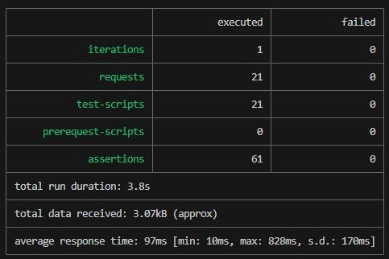

# Evidencias de funcionamiento

Ejecución de la colección [`recursos.postman_collection.json`](recursos.postman_collection.json) con Newman contra la aplicación desplegada en **Payara Server 6 dentro de Docker** (`main` final, 2026-10-15 01:26:26 UTC).

| Peticiones | Verificaciones | Fallos |
|---|---|---|
| 21 | 61 | 0 |

Salida completa de Newman: [`newman-salida.txt`](newman-salida.txt).



## Registro del EJB en JNDI

Línea del log de Payara al desplegar: el contenedor registra el EJB por su interfaz de negocio.

```text
Portable JNDI names for EJB ResourceRequestServiceBean: [java:global/recursos/ResourceRequestServiceBean!co.edu.javeriana.recursos.business.contract.ResourceRequestService, java:global/recursos/ResourceRequestServiceBean]
```

## Resumen por operación

| # | Carpeta | Operación | Petición | HTTP | Verificaciones |
|---|---|---|---|---|---|
| 1 | 1. Operaciones | Registrar solicitud (ALTA) | `POST /recursos/api/requests` | 201 | 4/4 ✅ |
| 2 | 1. Operaciones | Registrar solicitud (MEDIA) | `POST /recursos/api/requests` | 201 | 2/2 ✅ |
| 3 | 1. Operaciones | Consultar todas | `GET /recursos/api/requests` | 200 | 2/2 ✅ |
| 4 | 1. Operaciones | Consultar por id | `GET /recursos/api/requests/1` | 200 | 3/3 ✅ |
| 5 | 1. Operaciones | Consultar pendientes (antes de atender) | `GET /recursos/api/requests/pending` | 200 | 3/3 ✅ |
| 6 | 1. Operaciones | Atender solicitud | `PUT /recursos/api/requests/1/attend` | 200 | 2/2 ✅ |
| 7 | 1. Operaciones | Consultar pendientes (después de atender) | `GET /recursos/api/requests/pending` | 200 | 3/3 ✅ |
| 8 | 2. Reglas de negocio | Atender una solicitud ya ATENDIDA | `PUT /recursos/api/requests/1/attend` | 409 | 3/3 ✅ |
| 9 | 2. Reglas de negocio | Atender una solicitud inexistente | `PUT /recursos/api/requests/999999/attend` | 404 | 3/3 ✅ |
| 10 | 2. Reglas de negocio | Consultar una solicitud inexistente | `GET /recursos/api/requests/999999` | 404 | 3/3 ✅ |
| 11 | 2. Reglas de negocio | Cantidad cero | `POST /recursos/api/requests` | 400 | 3/3 ✅ |
| 12 | 2. Reglas de negocio | Cantidad negativa | `POST /recursos/api/requests` | 400 | 3/3 ✅ |
| 13 | 2. Reglas de negocio | Sin cantidad | `POST /recursos/api/requests` | 400 | 3/3 ✅ |
| 14 | 2. Reglas de negocio | Descripción vacía | `POST /recursos/api/requests` | 400 | 3/3 ✅ |
| 15 | 2. Reglas de negocio | Sin descripción | `POST /recursos/api/requests` | 400 | 3/3 ✅ |
| 16 | 2. Reglas de negocio | Tipo de recurso vacío | `POST /recursos/api/requests` | 400 | 3/3 ✅ |
| 17 | 2. Reglas de negocio | Prioridad inválida | `POST /recursos/api/requests` | 400 | 3/3 ✅ |
| 18 | 2. Reglas de negocio | Sin prioridad | `POST /recursos/api/requests` | 400 | 3/3 ✅ |
| 19 | 3. Errores de entrada (HTTP) | Cuerpo vacío | `POST /recursos/api/requests` | 400 | 3/3 ✅ |
| 20 | 3. Errores de entrada (HTTP) | JSON mal formado | `POST /recursos/api/requests` | 400 | 3/3 ✅ |
| 21 | 3. Errores de entrada (HTTP) | Tipo de dato incorrecto | `POST /recursos/api/requests` | 400 | 3/3 ✅ |

## 1. Operaciones

### 1. Registrar solicitud (ALTA)

```http
POST /recursos/api/requests
Content-Type: application/json

{
  "disasterDescription": "Inundación en el sector norte",
  "resourceType": "Agua potable",
  "quantity": 200,
  "priority": "ALTA"
}
```

Respuesta: **HTTP 201 Created**

```json
{
  "disasterDescription": "Inundación en el sector norte",
  "id": 1,
  "priority": "ALTA",
  "quantity": 200,
  "resourceType": "Agua potable",
  "status": "PENDIENTE"
}
```

- ✅ HTTP 201
- ✅ se asigna id
- ✅ inicia PENDIENTE
- ✅ header Location

### 2. Registrar solicitud (MEDIA)

```http
POST /recursos/api/requests
Content-Type: application/json

{
  "disasterDescription": "Incendio forestal en la vereda El Retiro",
  "resourceType": "Mantas",
  "quantity": 50,
  "priority": "MEDIA"
}
```

Respuesta: **HTTP 201 Created**

```json
{
  "disasterDescription": "Incendio forestal en la vereda El Retiro",
  "id": 2,
  "priority": "MEDIA",
  "quantity": 50,
  "resourceType": "Mantas",
  "status": "PENDIENTE"
}
```

- ✅ HTTP 201
- ✅ inicia PENDIENTE

### 3. Consultar todas

```http
GET /recursos/api/requests
```

Respuesta: **HTTP 200 OK**

```json
[
  {
    "disasterDescription": "Inundación en el sector norte",
    "id": 1,
    "priority": "ALTA",
    "quantity": 200,
    "resourceType": "Agua potable",
    "status": "PENDIENTE"
  },
  {
    "disasterDescription": "Incendio forestal en la vereda El Retiro",
    "id": 2,
    "priority": "MEDIA",
    "quantity": 50,
    "resourceType": "Mantas",
    "status": "PENDIENTE"
  }
]
```

- ✅ HTTP 200
- ✅ incluye las dos registradas

### 4. Consultar por id

```http
GET /recursos/api/requests/1
```

Respuesta: **HTTP 200 OK**

```json
{
  "disasterDescription": "Inundación en el sector norte",
  "id": 1,
  "priority": "ALTA",
  "quantity": 200,
  "resourceType": "Agua potable",
  "status": "PENDIENTE"
}
```

- ✅ HTTP 200
- ✅ es la solicitud pedida
- ✅ datos completos

### 5. Consultar pendientes (antes de atender)

```http
GET /recursos/api/requests/pending
```

Respuesta: **HTTP 200 OK**

```json
[
  {
    "disasterDescription": "Inundación en el sector norte",
    "id": 1,
    "priority": "ALTA",
    "quantity": 200,
    "resourceType": "Agua potable",
    "status": "PENDIENTE"
  },
  {
    "disasterDescription": "Incendio forestal en la vereda El Retiro",
    "id": 2,
    "priority": "MEDIA",
    "quantity": 50,
    "resourceType": "Mantas",
    "status": "PENDIENTE"
  }
]
```

- ✅ HTTP 200
- ✅ todas PENDIENTE
- ✅ incluye la de agua

### 6. Atender solicitud

```http
PUT /recursos/api/requests/1/attend
```

Respuesta: **HTTP 200 OK**

```json
{
  "disasterDescription": "Inundación en el sector norte",
  "id": 1,
  "priority": "ALTA",
  "quantity": 200,
  "resourceType": "Agua potable",
  "status": "ATENDIDA"
}
```

- ✅ HTTP 200
- ✅ queda ATENDIDA

### 7. Consultar pendientes (después de atender)

```http
GET /recursos/api/requests/pending
```

Respuesta: **HTTP 200 OK**

```json
[
  {
    "disasterDescription": "Incendio forestal en la vereda El Retiro",
    "id": 2,
    "priority": "MEDIA",
    "quantity": 50,
    "resourceType": "Mantas",
    "status": "PENDIENTE"
  }
]
```

- ✅ HTTP 200
- ✅ ya no incluye la atendida
- ✅ sigue incluyendo la de mantas

## 2. Reglas de negocio

### 8. Atender una solicitud ya ATENDIDA

```http
PUT /recursos/api/requests/1/attend
```

Respuesta: **HTTP 409 Conflict**

```json
{
  "code": "ALREADY_ATTENDED",
  "message": "La solicitud con id 1 ya fue atendida",
  "timestamp": "2026-10-15T01:26:27.797994691Z"
}
```

- ✅ HTTP 409
- ✅ code = ALREADY_ATTENDED
- ✅ respuesta de error uniforme

### 9. Atender una solicitud inexistente

```http
PUT /recursos/api/requests/999999/attend
```

Respuesta: **HTTP 404 Not Found**

```json
{
  "code": "REQUEST_NOT_FOUND",
  "message": "No existe la solicitud con id 999999",
  "timestamp": "2026-10-15T01:26:27.904454848Z"
}
```

- ✅ HTTP 404
- ✅ code = REQUEST_NOT_FOUND
- ✅ respuesta de error uniforme

### 10. Consultar una solicitud inexistente

```http
GET /recursos/api/requests/999999
```

Respuesta: **HTTP 404 Not Found**

```json
{
  "code": "REQUEST_NOT_FOUND",
  "message": "No existe la solicitud con id 999999",
  "timestamp": "2026-10-15T01:26:27.997491498Z"
}
```

- ✅ HTTP 404
- ✅ code = REQUEST_NOT_FOUND
- ✅ respuesta de error uniforme

### 11. Cantidad cero

```http
POST /recursos/api/requests
Content-Type: application/json

{
  "disasterDescription": "Inundación en el sector norte",
  "resourceType": "Agua potable",
  "quantity": 0,
  "priority": "ALTA"
}
```

Respuesta: **HTTP 400 Bad Request**

```json
{
  "code": "VALIDATION_ERROR",
  "message": "La cantidad debe ser mayor que cero",
  "timestamp": "2026-10-15T01:26:28.077682416Z"
}
```

- ✅ HTTP 400
- ✅ code = VALIDATION_ERROR
- ✅ respuesta de error uniforme

### 12. Cantidad negativa

```http
POST /recursos/api/requests
Content-Type: application/json

{
  "disasterDescription": "Inundación en el sector norte",
  "resourceType": "Agua potable",
  "quantity": -5,
  "priority": "ALTA"
}
```

Respuesta: **HTTP 400 Bad Request**

```json
{
  "code": "VALIDATION_ERROR",
  "message": "La cantidad debe ser mayor que cero",
  "timestamp": "2026-10-15T01:26:28.175003734Z"
}
```

- ✅ HTTP 400
- ✅ code = VALIDATION_ERROR
- ✅ respuesta de error uniforme

### 13. Sin cantidad

```http
POST /recursos/api/requests
Content-Type: application/json

{
  "disasterDescription": "Inundación en el sector norte",
  "resourceType": "Agua potable",
  "priority": "ALTA"
}
```

Respuesta: **HTTP 400 Bad Request**

```json
{
  "code": "VALIDATION_ERROR",
  "message": "La cantidad es obligatoria",
  "timestamp": "2026-10-15T01:26:28.268417174Z"
}
```

- ✅ HTTP 400
- ✅ code = VALIDATION_ERROR
- ✅ respuesta de error uniforme

### 14. Descripción vacía

```http
POST /recursos/api/requests
Content-Type: application/json

{
  "disasterDescription": "   ",
  "resourceType": "Agua potable",
  "quantity": 200,
  "priority": "ALTA"
}
```

Respuesta: **HTTP 400 Bad Request**

```json
{
  "code": "VALIDATION_ERROR",
  "message": "La descripción del desastre es obligatoria",
  "timestamp": "2026-10-15T01:26:28.363968245Z"
}
```

- ✅ HTTP 400
- ✅ code = VALIDATION_ERROR
- ✅ respuesta de error uniforme

### 15. Sin descripción

```http
POST /recursos/api/requests
Content-Type: application/json

{
  "resourceType": "Agua potable",
  "quantity": 200,
  "priority": "ALTA"
}
```

Respuesta: **HTTP 400 Bad Request**

```json
{
  "code": "VALIDATION_ERROR",
  "message": "La descripción del desastre es obligatoria",
  "timestamp": "2026-10-15T01:26:28.457134582Z"
}
```

- ✅ HTTP 400
- ✅ code = VALIDATION_ERROR
- ✅ respuesta de error uniforme

### 16. Tipo de recurso vacío

```http
POST /recursos/api/requests
Content-Type: application/json

{
  "disasterDescription": "Inundación en el sector norte",
  "resourceType": "",
  "quantity": 200,
  "priority": "ALTA"
}
```

Respuesta: **HTTP 400 Bad Request**

```json
{
  "code": "VALIDATION_ERROR",
  "message": "El tipo de recurso es obligatorio",
  "timestamp": "2026-10-15T01:26:28.551197556Z"
}
```

- ✅ HTTP 400
- ✅ code = VALIDATION_ERROR
- ✅ respuesta de error uniforme

### 17. Prioridad inválida

```http
POST /recursos/api/requests
Content-Type: application/json

{
  "disasterDescription": "Inundación en el sector norte",
  "resourceType": "Agua potable",
  "quantity": 200,
  "priority": "URGENTE"
}
```

Respuesta: **HTTP 400 Bad Request**

```json
{
  "code": "VALIDATION_ERROR",
  "message": "La prioridad debe ser BAJA, MEDIA o ALTA",
  "timestamp": "2026-10-15T01:26:28.645283169Z"
}
```

- ✅ HTTP 400
- ✅ code = VALIDATION_ERROR
- ✅ respuesta de error uniforme

### 18. Sin prioridad

```http
POST /recursos/api/requests
Content-Type: application/json

{
  "disasterDescription": "Inundación en el sector norte",
  "resourceType": "Agua potable",
  "quantity": 200
}
```

Respuesta: **HTTP 400 Bad Request**

```json
{
  "code": "VALIDATION_ERROR",
  "message": "La prioridad es obligatoria",
  "timestamp": "2026-10-15T01:26:28.721849663Z"
}
```

- ✅ HTTP 400
- ✅ code = VALIDATION_ERROR
- ✅ respuesta de error uniforme

## 3. Errores de entrada (HTTP)

### 19. Cuerpo vacío

```http
POST /recursos/api/requests
Content-Type: application/json

(sin cuerpo)
```

Respuesta: **HTTP 400 Bad Request**

```json
{
  "code": "EMPTY_BODY",
  "message": "El cuerpo de la solicitud es obligatorio",
  "timestamp": "2026-10-15T01:26:28.827208155Z"
}
```

- ✅ HTTP 400
- ✅ code = EMPTY_BODY
- ✅ respuesta de error uniforme

### 20. JSON mal formado

```http
POST /recursos/api/requests
Content-Type: application/json

{"quantity": 
```

Respuesta: **HTTP 400 Bad Request**

```json
{
  "code": "MALFORMED_JSON",
  "message": "El cuerpo no es un JSON válido o tiene tipos incorrectos",
  "timestamp": "2026-10-15T01:26:28.978970232Z"
}
```

- ✅ HTTP 400
- ✅ code = MALFORMED_JSON
- ✅ respuesta de error uniforme

### 21. Tipo de dato incorrecto

```http
POST /recursos/api/requests
Content-Type: application/json

{"disasterDescription":"x","resourceType":"y","quantity":"muchos","priority":"ALTA"}
```

Respuesta: **HTTP 400 Bad Request**

```json
{
  "code": "MALFORMED_JSON",
  "message": "El cuerpo no es un JSON válido o tiene tipos incorrectos",
  "timestamp": "2026-10-15T01:26:29.106246258Z"
}
```

- ✅ HTTP 400
- ✅ code = MALFORMED_JSON
- ✅ respuesta de error uniforme
