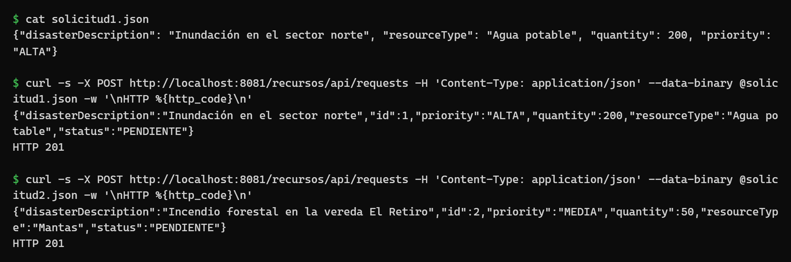
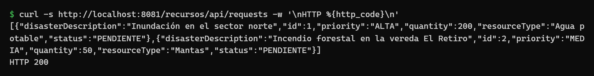
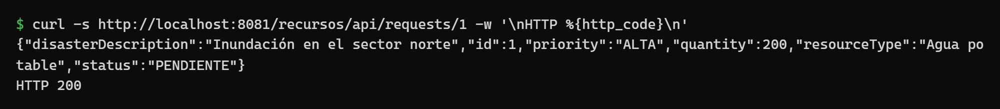
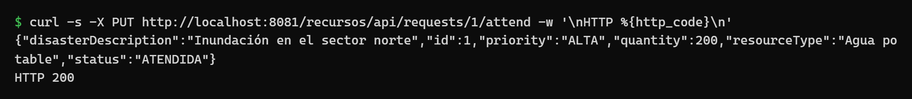
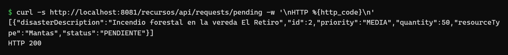
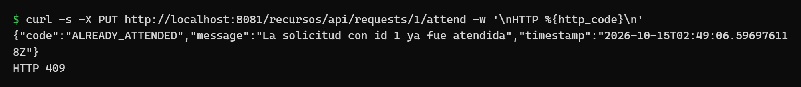

# Evidencias de funcionamiento

## Pruebas unitarias

Se ejecutan con `mvn clean test`, sin servidor. Resultado: 46 pruebas, 0 fallos.

| Clase de prueba | Pruebas | Qué verifica |
|---|---|---|
| `ResourceRequestServiceBeanTest` | 21 | Reglas de negocio del EJB con un repositorio simulado |
| `InMemoryResourceRequestRepositoryTest` | 11 | Generación de identificadores, copias y acceso concurrente |
| `ResourceRequestResourceTest` | 7 | La API delega en el servicio y responde 201 o 200 |
| `ExceptionMappersTest` | 7 | Cada excepción produce su código HTTP |

## Operaciones principales

Se levantó la aplicación con Docker (`docker run -p 8081:8080 recursos-negocio`) y se ejecutaron las operaciones con `curl`, en este orden, sobre un contenedor recién iniciado.

**Registrar dos solicitudes**



**Consultar todas las solicitudes**



**Consultar una solicitud por identificador**



**Atender la solicitud 1**



**Consultar las solicitudes pendientes (la solicitud 1 ya no aparece)**



**Intentar atender de nuevo la solicitud 1**



## Colección completa de pruebas

Además se ejecutó la colección de Postman [`recursos.postman_collection.json`](recursos.postman_collection.json) con Newman. Cada petición verifica el código HTTP y el contenido de la respuesta. Resultado: 21 peticiones, 61 verificaciones, 0 fallos. La salida completa está en [`newman-salida.txt`](newman-salida.txt).


| # | Caso | Petición | Respuesta obtenida |
|---|---|---|---|
| 1 | Registrar solicitud (ALTA) | `POST /requests` | 201, estado PENDIENTE, id 1 |
| 2 | Registrar solicitud (MEDIA) | `POST /requests` | 201, estado PENDIENTE, id 2 |
| 3 | Consultar todas | `GET /requests` | 200, solicitudes 1 y 2 |
| 4 | Consultar por id | `GET /requests/1` | 200, solicitud 1 |
| 5 | Consultar pendientes | `GET /requests/pending` | 200, solicitudes 1 y 2 |
| 6 | Atender solicitud | `PUT /requests/1/attend` | 200, estado ATENDIDA |
| 7 | Consultar pendientes | `GET /requests/pending` | 200, solo la solicitud 2 |
| 8 | Atender una solicitud ya atendida | `PUT /requests/1/attend` | 409 `ALREADY_ATTENDED` |
| 9 | Atender una solicitud inexistente | `PUT /requests/999999/attend` | 404 `REQUEST_NOT_FOUND` |
| 10 | Consultar una solicitud inexistente | `GET /requests/999999` | 404 `REQUEST_NOT_FOUND` |
| 11 | Cantidad cero | `POST /requests` | 400 `VALIDATION_ERROR` |
| 12 | Cantidad negativa | `POST /requests` | 400 `VALIDATION_ERROR` |
| 13 | Sin cantidad | `POST /requests` | 400 `VALIDATION_ERROR` |
| 14 | Descripción vacía | `POST /requests` | 400 `VALIDATION_ERROR` |
| 15 | Sin descripción | `POST /requests` | 400 `VALIDATION_ERROR` |
| 16 | Tipo de recurso vacío | `POST /requests` | 400 `VALIDATION_ERROR` |
| 17 | Prioridad inválida | `POST /requests` | 400 `VALIDATION_ERROR` |
| 18 | Sin prioridad | `POST /requests` | 400 `VALIDATION_ERROR` |
| 19 | Cuerpo vacío | `POST /requests` | 400 `EMPTY_BODY` |
| 20 | JSON mal formado | `POST /requests` | 400 `MALFORMED_JSON` |
| 21 | Tipo de dato incorrecto | `POST /requests` | 400 `MALFORMED_JSON` |

Al desplegar, Payara registra el EJB en JNDI por su interfaz de negocio:

```
Portable JNDI names for EJB ResourceRequestServiceBean:
[java:global/recursos/ResourceRequestServiceBean!co.edu.javeriana.recursos.business.contract.ResourceRequestService,
 java:global/recursos/ResourceRequestServiceBean]
```

Para repetir la ejecución con la aplicación levantada:

```bash
npx newman run docs/evidencias/recursos.postman_collection.json \
  --env-var "baseUrl=http://localhost:8080/recursos/api"
```
